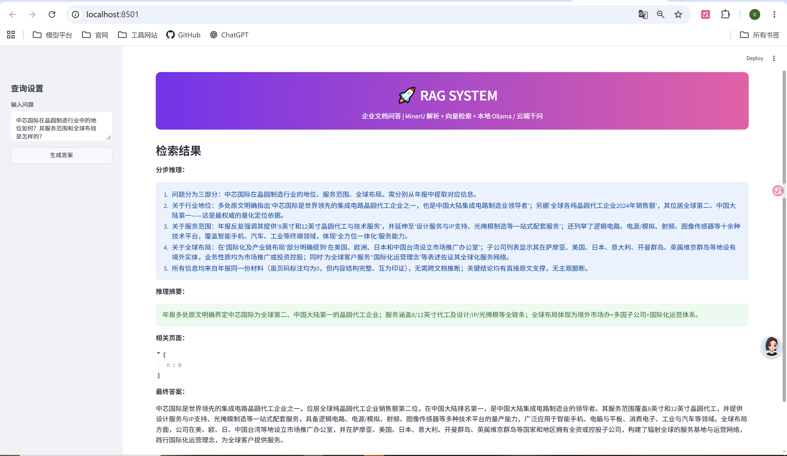

# RAG 企业财报智能问答系统

> 基于检索增强生成（RAG）的企业财报智能问答系统。将 PDF 解析换轨为 **MinerU 云 API**，生成与嵌入模型支持**本地 Ollama / 云端千问 DashScope** 一键切换（默认云端 `qwen-plus` 生成 + `text-embedding-v3` 嵌入，可切回本地 `qwen2.5:7b` + `bge-m3`），并针对**中芯国际年报/券商研报**完成中文本地化适配，使用 Streamlit 可视化问答界面。

- MinerU 云 API 解析 PDF → Markdown
- FAISS 向量检索（bge-m3 本地嵌入 / text-embedding-v3 云端嵌入）+ 可选 BM25 关键词检索
- 父文档检索（Parent Document Retrieval）两阶段召回
- LLM 重排（LLM 相关性打分与向量距离加权融合）
- 思维链（CoT）+ Pydantic 结构化输出
- 多公司比较类问题的查询路由
- 抗幻觉的引用页码校验

## 快速开始

python -m venv .venv
.venv\Scripts\Activate.ps1
.\.venv\Scripts\python.exe -m pip install --upgrade pip
.\.venv\Scripts\python.exe -m pip install -e . -r requirements.txt

在 Windows 上，后续运行项目时也请使用 `.\.venv\Scripts\python.exe`，确保使用同一个虚拟环境。

配置项目根目录 `.env` 文件的模型配置（生成模型与嵌入模型分别通过 `LLM_PROVIDER` / `EMBEDDING_PROVIDER` 在 `ollama` 与 `qwen` 之间切换）：

- **云端千问（默认）**：在 `.env` 中填入 `QWEN_API_KEY`，将 `LLM_PROVIDER=qwen`、`EMBEDDING_PROVIDER=qwen` 即可，无需本地 GPU。
- **本地 Ollama**：安装并启动 [Ollama](https://ollama.com/) 后下载模型，再把 `LLM_PROVIDER=ollama`、`EMBEDDING_PROVIDER=ollama`：
  ollama pull qwen2.5:7b
  ollama pull bge-m3

运行前请确保所选 provider 对应服务可用（云端需网络可达 `dashscope.aliyuncs.com`，本地需 Ollama 已启动且模型已下载）。

> 切换嵌入模型后，旧 FAISS 索引不能复用，需重新生成向量库（见下文「部分配置」）。

## 测试数据集

RAG-Challenge-2-main\data\stock_data\pdf_reports

## 使用方法

可以通过注释 `src/pipeline.py` 的方法来运行流水线的任意部分，并执行：
.\.venv\Scripts\python.exe .\src\pipeline.py

也可以使用 `main.py` 运行任意流水线阶段，但需要在包含数据的目录中执行：
cd .\data\test_set\
..\..\.venv\Scripts\python.exe ..\..\main.py process-questions --config max_nst_o3m

### CLI 命令

获取可用命令的帮助：
.\.venv\Scripts\python.exe main.py --help

可用命令：

- `download-models` - 下载所需的 Docling 模型
- `parse-pdfs` - 使用并行处理选项解析 PDF 报告
- `serialize-tables` - 处理已解析报告中的表格
- `process-reports` - 对已解析报告运行完整流水线
- `process-questions` - 使用指定配置处理问题

每个命令都有自己的选项。例如：
.\.venv\Scripts\python.exe main.py parse-pdfs --help

## 显示类似 --parallel/--sequential, --chunk-size, --max-workers 的选项

.\.venv\Scripts\python.exe main.py process-reports --config ser_tab

## 使用序列化表格配置处理报告

## 部分配置

- 各问答配置均使用 `.env` 中配置的模型（`LLM_PROVIDER` / `EMBEDDING_PROVIDER` 决定走 Ollama 还是千问）；保留配置名以兼容原有命令

切换嵌入模型（如 `bge-m3` ↔ `text-embedding-v3`）后，旧数据集提供的 FAISS 索引不能直接复用。确保已解压 `debug_data` 中的解析报告，然后在数据集目录重新生成向量库：
cd .\data\test_set
python ..\..\main.py process-reports --config no_ser_tab
python ..\..\main.py process-questions --config max_nst_o3m

完整 ERC2 数据集请将 `test_set` 替换为 `erc2_set`。重建索引会调用 `.env` 中 `EMBEDDING_PROVIDER` 指定的嵌入模型（本地 bge-m3 或云端 text-embedding-v3）。

查看 `pipeline.py` 以获取更多配置及其详细信息。

## 项目详细介绍

### 1. 项目定位

本项目是一个面向**企业年报 / 券商研报**的检索增强生成（RAG）问答系统：给定一组 PDF 文档与若干问题，自动完成「解析 → 分块 → 索引 → 检索 → 生成 → 后处理」，输出带引用来源的结构化答案。

当前默认数据为**中芯国际（688981）**财报研报集（`data/stock_data/`，含 9 份 PDF：1 份年报 + 7 份券商研报 + 1 份机构调研纪要）。模型默认使用**云端千问**（`qwen-plus` 生成 + `text-embedding-v3` 嵌入），也可在 `.env` 切回**本地 Ollama**（`qwen2.5:7b` + `bge-m3`）。

### 2. 整体数据流

```
PDF 原始文件
   │  ① export_reports_to_markdown()   ← MinerU 云 API（提交任务 → 轮询 → 下载解压）
   ▼
Markdown（debug_data/03_reports_markdown/*.md）
   │  ② chunk_reports()                ← TextSplitter 按行分块（30 行/块，重叠 5 行）
   ▼
分块 JSON（databases/chunked_reports/*.json）
   │  ③ create_vector_dbs()            ← VectorDBIngestor：嵌入（bge-m3 / text-embedding-v3）+ FAISS IndexFlatIP
   ▼
向量库（databases/vector_dbs/{sha1}.faiss）
   │  ④ process_questions()            ← QuestionsProcessor：检索 → 重排 → 结构化问答 → 引用校验
   ▼
answers.json（另含 *_debug.json 调试详情）
```

### 3. 核心模块

| 文件 | 职责 |
|------|------|
| `src/pdf_mineru.py` | 封装 MinerU 云 API：提交解析任务、轮询状态、下载并解压出 `full.md` |
| `src/text_splitter.py` | 将 Markdown 按行分块（30 行/块、重叠 5 行），记录起止行号与文本，输出 `metainfo + chunks` JSON |
| `src/ingestion.py` | `VectorDBIngestor`（bge-m3 / text-embedding-v3 嵌入 + FAISS 向量库）、`BM25Ingestor`（关键词索引） |
| `src/retrieval.py` | `VectorRetriever`（语义检索）、`BM25Retriever`（关键词检索）、`HybridRetriever`（向量 + LLM 重排） |
| `src/reranking.py` | `LLMReranker`（LLM 相关性打分 + 向量距离加权融合）、`JinaReranker`（Jina API 重排） |
| `src/prompts.py` | 集中定义所有提示词与 Pydantic 输出 Schema（问答/比较/重排/问题重写/schema 修复） |
| `src/api_requests.py` | LLM 交互统一出口：消息发送、结构化输出、JSON 修复与重解析、多 Provider 路由 |
| `src/questions_processing.py` | 问答主链路：公司名抽取、检索调用、RAG 上下文构建、LLM 问答、引用校验、答案后处理 |
| `src/pipeline.py` | 总调度入口，串联各阶段；定义 `PipelineConfig` / `RunConfig` 与实验配置 |
| `src/model_client.py` | 读取 `.env` 配置，统一封装 Ollama / 千问的 chat / embedding 客户端与 provider 切换（`src/ollama_client.py` 为兼容旧脚本的再导出） |
| `src/api_request_parallel_processor.py` | 异步批量请求处理器：流式读取、tokens 级限流、自动重试、日志记录 |
| `main.py` | 基于 click 的命令行入口（`process-reports` / `process-questions`） |
| `app_streamlit.py` | Streamlit 可视化问答界面 |

### 4. 关键技术点

**① 检索策略（Retrieval）**

- **向量语义检索**：嵌入模型生成 1024 维向量（本地 `bge-m3` 或云端 `text-embedding-v3`），`faiss.IndexFlatIP` 做内积（余弦）相似度检索。
- **BM25 关键词检索**：`rank_bm25` 构建词频索引，适合精确关键词匹配。
- **父文档检索（Parent Document Retrieval）**：先召回最相关的父文档（整段/整页），再在其中做细粒度匹配，缓解长文档切块导致的语义割裂。
- **混合检索 + LLM 重排**：`HybridRetriever` 先用向量检索召回候选，再交给 `LLMReranker` 打分，最终按 `llm_weight * LLM分数 + (1 - llm_weight) * 向量分数` 加权融合重排（默认 `llm_weight=0.7`）。

**② 查询路由（Query Routing）**

对多公司比较类问题（如「哪家公司营收更高」），先用 LLM 拆解为针对各公司的独立子问题，并行检索/回答后汇总比较、给出唯一结论，并支持币种不符自动排除等规则。

**③ 思维链 + 结构化输出（CoT + Structured Output）**

- 所有答案统一用 Pydantic `AnswerSchema` 约束为四段式：`step_by_step_analysis`（分步推理 ≥5 步）/ `reasoning_summary`（推理摘要）/ `relevant_pages`（引用页码）/ `final_answer`（最终答案）。
- 提示词内置「严格指标匹配」规则（单位、币种、千/百万换算、负数括号、禁止由其他指标推算等），显著减少幻觉与误答。
- 结构化输出不稳定时，通过 `json_repair` 修复 + `AnswerSchemaFixPrompt` 二次解析兜底。

**④ 抗幻觉引用校验（Reference Validation）**

对 LLM 返回的引用页码做真实性校验：剔除不在检索结果中的「幻觉页码」，不足时自动补全 top 页、超限时裁剪，保证答案可溯源到真实文档。

**⑤ 本地化低成本部署**

- 模型可切换：云端千问（`qwen-plus` 生成 + `text-embedding-v3` 嵌入）或本地 Ollama（`qwen2.5:7b` 生成 + `bge-m3` 嵌入），由 `.env` 的 `LLM_PROVIDER` / `EMBEDDING_PROVIDER` 控制。
- `api_requests.py` 提供 OpenAI 兼容（Ollama / 千问）多 Provider 统一接口，便于切换。

**⑥ 异步并发与限流**

`api_request_parallel_processor.py` 基于 `aiohttp` 实现异步批量请求：流式读取 JSONL、按请求数与 token 数双重限流、失败自动重试，适合大规模批量嵌入/推理。

**⑦ 中文本地化适配**

- 中文 Windows 常见 GBK 编码自动回退（`utf-8 → gbk`）。
- 中文公司名抽取改用「包含匹配」替代正则边界匹配，避免中文紧邻字符导致漏匹配。
- 全中文提示词与 Schema 描述。

**⑧ 可视化交互**

`app_streamlit.py` 提供 Web 问答界面，支持单问题即时推理，分栏展示分步推理 / 推理摘要 / 相关页面 / 最终答案。

### 5. 配置体系

- `PipelineConfig`：**路径配置**，管理输入 PDF、中间产物（Markdown、分块 JSON）、向量库、答案文件等所有路径。
- `RunConfig`：**算法策略配置**，控制是否启用父文档检索、LLM 重排、并发数、`top_n`、模型、是否全文上下文等。
- `configs`：内置三档实验预设——`base`（基础检索）、`pdr`（+ 父文档检索）、`max`（+ 父文档检索 + LLM 重排），便于对比消融实验。

### 6. 已知限制

- MinerU 按行分块无「页码」语义，`relevant_pages` 字段退化为行号/占位值（当前默认数据为单文档问答，影响有限）。
- 本地 `qwen2.5:7b` 在复杂 JSON Schema 约束下偶发不遵循结构，生产建议换更强模型或云端原生结构化输出 API。
- `pdf_mineru.py` 中的 API key 属敏感信息，纳入版本管理时请及时轮换或改为环境变量读取。

## 运行截图

